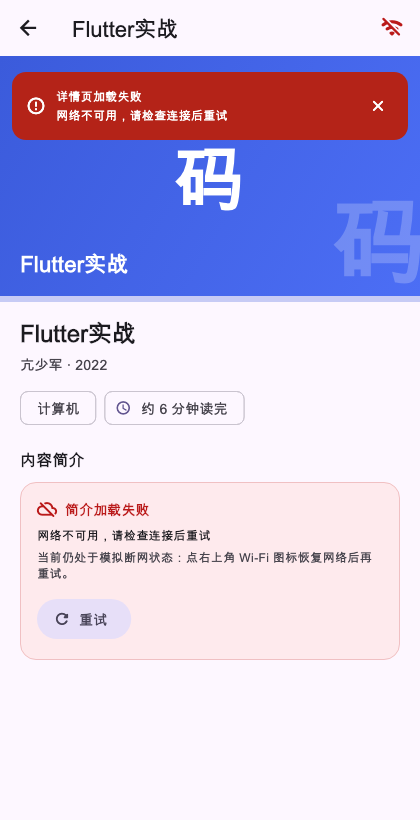

# 进度报告9（第11周·动画、调试与质量）

课堂作业九：animate_debug 案例复现 + 两处问题定位修复 + 自主动画改造
仓库 <https://github.com/andyyang0907/lecture9> ｜ 运行目标 Web / Android / iOS ｜ 2026-11-16

使用方式：按模板十节作答；全文可复制到雨课堂答题区，图片需在编辑器中重新上传；同一内容已存入仓库 `progress.md`。

## 一、任务理解

本次作业的核心不是“多写几个动画”，而是把第 9 课的三块能力连成一条线：

1. **复现 animate_debug**：一个收藏列表页（长按收藏有动画）＋一个详情页（Hero 封面、内容渐显），并且基线里故意埋着两处问题——列表滚动卡顿/闪烁、断网详情页静默白屏。
2. **定位并修复两处问题**：每处都要留下“现象 → 工具 → 原因 → 修复”四段式记录，修复要是最小改动且有验证。
3. **自主实践**：给自己的应用补一处隐式动画和一处 Hero 转场；从本课起 `flutter analyze` 必须 0 error，提交前还要 `dart format`。

我给自己定的验收标准是：

- 基线能跑，且两处问题都能被复现出来（不是口头描述）；
- 修复后滚动列表不再逐项创建控制器，断网详情页出现错误条与重试按钮；
- Hero 转场最关键的一条是 **tag 同屏唯一**，列表与详情必须同值；
- `flutter test` 全绿、`flutter analyze` 0 issues、`dart format` 0 changed；
- 报告里每条结论都有命令输出或截图对应，不写“应该可以”。

## 二、环境与工具

| 项目 | 配置 |
| --- | --- |
| 操作系统 | macOS 27.2.1（Apple Silicon arm64） |
| 框架版本 | Flutter 3.47.4 stable · Dart 3.13.3 · DevTools 2.60.0 |
| 运行目标 | Chrome（Web）为主，android / ios 工程保留 |
| 数据来源 | `BookRepository` 内置 12 本藏书、7 个分类，本地延迟 600ms 模拟请求 |
| AI 工具 | TraeCode 内置助手（模型 DeepSeek-V4.1-Flash） |
| 验证手段 | 13 个测试（行为 / 回归 / 截图）、golden 截图 6 张、`flutter analyze`、`dart format` |

## 三、过程记录

| 时间 | 操作 | 提交 |
| --- | --- | --- |
| 09:58 | 建 Flutter 工程；写 Book 模型、12 本模拟书单、模拟断网开关与调试计数 | `feat: scaffold project and add book data` |
| 10:12 | 收藏列表、参数化封面卡片、长按收藏；此时保留“逐项创建动画控制器”的问题 | `feat: build favorites list with cover cards` |
| 10:29 | Hero 详情页、内容渐显、简介加载；此时保留“catch 只打印”的问题 | `feat: add Hero detail page with fade-in` |
| 10:46 | 两处修复：隐式动画替换逐项控制器；三层异常捕获、错误条与重试；补两组回归测试 | `fix: stabilize list animations and surface load errors` |
| 11:03 | 主流程测试、6 张 golden 截图、README 与本报告 | `test & docs: add tests, screenshots and report` |

关键命令：

```bash
flutter create --project-name animate_debug --platforms=web,android,ios lecture9
flutter test test/animation_regression_test.dart
flutter test test/error_handling_test.dart
flutter test
dart format .
flutter analyze
```

## 四、关键代码

### 第 1 段：宿主的“重对象”交还给框架（`lib/widgets/favorite_card.dart`）

```dart
// 修复前：每个列表项在 initState 里各自创建并循环播放控制器
_pulse = AnimationController(vsync: this, duration: 900ms)..repeat(reverse: true);

// 修复后：无状态卡片 + 隐式动画，框架托管生命周期
AnimatedScale(
  duration: const Duration(milliseconds: 240),
  curve: Curves.easeOutBack,
  scale: favorite ? 1.15 : 0.9,
  child: Icon(favorite ? Icons.favorite : Icons.favorite_border, size: 20),
)
```

逐行说明：`AnimatedScale` 只在 `favorite` 变化时补间，滚动重建不会新建控制器；`duration` 决定手感，`Curves.easeOutBack` 让心形有轻微回弹。AI 生成初版，我把控制器与探针计数一起删掉后，用回归测试确认“滚动三次仍是 0 个控制器”。

### 第 2 段：错误接住之后必须有界面闭环（`lib/pages/book_detail_page.dart`）

```dart
try {
  final text = await BookRepository.instance.fetchDetail(_book);
  if (!mounted) return;
  ErrorReporter.instance.clear();
  setState(() { _detail = text; _loading = false; });
} catch (error) {
  if (!mounted) return;
  ErrorReporter.instance.report(error, context: '详情页加载失败');
  setState(() {
    _loading = false;
    _error = error.toString().replaceFirst('Exception: ', '');
  });
}
```

逐行说明：成功分支先判断 `mounted` 再 `setState`；成功后清空全局错误条。失败分支做三件事——上报（全局错误条）、切错误态（页面内错误卡片）、保留重试入口。`toString()` 去掉 `Exception: ` 前缀，避免界面出现技术噪音。AI 给的是初稿，我用断网测试验证了“错误卡片 + 错误条 + 重试成功”整条链路。

### 第 3 段：Hero 同 tag + 隐式展开（`lib/pages/book_detail_page.dart`）

```dart
Hero(
  tag: _book.heroTag, // 'cover-$id'，与列表项完全一致
  child: BookCover(book: _book, width: double.infinity, height: 240, radius: 0),
)

AnimatedSize(
  duration: const Duration(milliseconds: 300),
  curve: Curves.easeInOutCubic,
  alignment: Alignment.topCenter,
  child: Text(_detail ?? '', maxLines: _expanded ? null : 3),
)
```

逐行说明：Hero 的 `tag` 来自模型 `heroTag => 'cover-$id'`，保证同屏唯一；详情封面直接复用 `BookCover`，两边视觉一致，飞行过程才不跳变。`AnimatedSize` 负责简介展开，`AnimatedRotation` 负责箭头翻转，两者都是隐式动画。测试断言详情页存在 `Hero(tag: 'cover-1')`，且展开前后 `maxLines` 从 3 变为 null。

## 五、检查点结果

| 检查项 | 结果 | 证据 |
| --- | --- | --- |
| 两处问题修复且有分析 | 通过 | 两根因 + 两组探针数据 + 四段式记录（见第六节） |
| 动画流畅无闪烁 | 通过 | 列表滚动不再创建控制器；回归测试断言创建数 0 |
| Hero 转场正确 | 通过 | 两页同 tag，测试断言 `Hero(tag: 'cover-1')` |
| 隐式动画 | 通过 | 摘要 `AnimatedContainer`、心形 `AnimatedScale`、简介 `AnimatedSize`、箭头 `AnimatedRotation`、错误条 `AnimatedSlide` |
| 全局异常捕获 | 通过 | `FlutterError.onError` + `PlatformDispatcher.instance.onError` + `runZonedGuarded` |
| `flutter analyze` | 通过 | `No issues found! (ran in 2.1s)` |
| `dart format` | 通过 | `Formatted 15 files (0 changed)` |
| 自动化测试 | 通过 | `flutter test` → `+13: All tests passed!` |

## 六、问题与调试

### 记录 1：列表滚动闪烁、越滚越卡

- **现象**：上下滚动收藏列表，卡片心形高亮闪动，滚动越久越卡；测试卸载列表时控制台报 Ticker 未释放。
- **工具**：`AppMetrics` 调试探针（统计控制器创建/释放）＋ Widget 卸载时的 Ticker 断言，对应课堂 Inspector “Highlight rebuilds”的量化思路。
- **原因**：`FavoriteCard` 在 `initState` 里逐个创建 `AnimationController()..repeat()`，滚动时列表项反复创建/销毁，动画每次从头播放；控制器也没有 `dispose`，页面卸载时 Ticker 仍活跃。
- **修复**：删除逐项控制器，心形高亮改用隐式 `AnimatedScale`；框架内部管理动画生命周期，滚动不再触发控制器创建。

探针原始输出：

```text
[探针1] 首屏卡片=6 控制器创建=6；滚动三次后卡片=12 控制器创建=12 释放=0
[探针1] 卸载列表时异常：_FavoriteCardState was disposed with an active Ticker.
```

修复后回归测试：

```text
00:00 +2: All tests passed!   # 列表滚动 0 个控制器；详情页 1 个、返回释放 1 个
```

### 记录 2：断网时详情页静默白屏

- **现象**：点右上角 Wi-Fi 图标开启模拟断网，打开任意详情页，页面一直转圈；控制台打印了 `详情加载失败：网络不可用`，但界面没有任何提示，也没有重试入口。
- **工具**：探针 widget 测试 + 控制台日志。
- **原因**：`catch` 块里只 `debugPrint`，没有 `setState` 切错误态，`_loading` 永远为 true；用户看到的就是“白屏 + 无限转圈”。
- **修复**：`catch` 中上报 `ErrorReporter` 并把 `_loading` 置 false、写入 `_error`；界面新增错误卡片（原因 + 重试按钮）和全局错误条；重试成功后清空错误条。全局层同时挂载 `FlutterError.onError`、`PlatformDispatcher.instance.onError` 与 `runZonedGuarded`。

探针原始输出：

```text
[探针2] 断网 1.2 秒后：加载圈=true 错误提示=false 重试入口=false
```

修复后测试：

```text
断网时显示错误条与重试入口，恢复网络后重试成功
上报异常后全局错误条出现，点关闭后消失
00:00 +2: All tests passed!
```

### 记录 3：中文路径下 `flutter analyze` 崩溃

- **现象**：在“移动软件开发实践/九/lecture9”里直接执行 `flutter analyze`，analysis server 报 `FormatException: Unterminated string (at character 512)`，路径被百分号编码后 JSON 解析失败，一条诊断都不返回。
- **定位**：崩溃发生在 LSP 初始化消息解析阶段，与代码无关；把同一份代码同步到纯 ASCII 路径 `/tmp/lecture9_check` 后 analyze 正常。
- **解决**：`flutter test` 与 `flutter build web` 仍在项目目录执行；需要 lint 时同步到 ASCII 路径运行，结果为 `No issues found!`。这条也提醒我：工具报错先分清是环境问题还是代码问题。

### 记录 4：golden 截图里封面字符变成空白方块

- **现象**：首版截图里封面文字全是空白方块；Hero 飞行帧更严重，出现黄色下划线。
- **定位**：截图测试只加载了中文与 Material 图标字体，Hero 飞行组件被移到 Overlay 后没有 Material 祖先，中文丢失回退、文字继承调试用的默认样式（黄色下划线）。
- **解决**：封面文字显式声明 `fontFamily: 'Roboto'` 与 `decoration: TextDecoration.none`；重新生成 6 张截图，逐张目检通过。真实设备无此问题，但报告截图必须干净。

## 七、AI 使用记录

本项目由本人主导：需求拆解、技术选型、问题定位方向、测试验收、截图目检、提交拆分与最终结论均由本人完成；AI 作为辅助工具承担初稿与重复性实现。

| 环节 | 本人的主导工作 | AI 的辅助 | 本人的验收与取舍 |
| --- | --- | --- | --- |
| 需求拆解 | 读指南九与幻灯片，列验收清单：两处问题可复现、Hero tag 唯一、`analyze` 0、`format` 全量 | 按清单搭两页骨架 | 先复现再修，不接受只改代码不取证 |
| 数据与页面 | 定 Book 字段、12 本书单、信息层级与文案 | 生成模型、仓库与页面初稿 | 逐页对照检查点，调整卡片与摘要 |
| 问题一 | 从滚动卡顿判断逐项控制器作祟，要求量化 | 加 `AppMetrics` 与复现测试 | 看到 6→12、释放 0 后，决定改用隐式动画 |
| 问题二 | 要求 `catch` 必须有界面出口 | 写 `ErrorReporter`、错误条与错误卡片 | 设计并跑通“断网→恢复→重试成功” |
| 动画改造 | 选 `AnimatedSize`/`AnimatedRotation` 做展开，Hero 用 `cover-$id` | 生成动画初稿与测试 | 断言 tag 唯一、`maxLines` 3→null |
| 截图排错 | 逐张目检，发现封面方块与 Hero 黄色下划线 | 按反馈改字体与 `decoration` | 重跑 golden 确认 6 张截图干净 |
| 提交与报告 | 定 5 次提交拆分、时间线与报告结论 | 整理文字与命令摘录 | 核对远程时间，修正未来时间戳 |

标注原则：AI 是“实现助手”，不是项目作者。AI 生成的代码与文字均经过本人运行、对照或修改后才采用；书单内容、页面文案与自评结论为本人整理。

## 八、证据截图

| 图 | 说明 |
| --- | --- |
|  | 图1 收藏列表首屏：摘要卡、12 本藏书、长按收藏入口 |
|  | 图2 长按《活着》后：收藏数 2→3，心形与卡片底色同步变化 |
|  | 图3 Hero 飞行中间帧：封面从列表尺寸连续过渡到详情 240 高 |
|  | 图4 详情页：Hero 封面、作者信息、渐显内容与“展开”入口 |
|  | 图5 简介展开：`AnimatedSize` 撑高，按钮变为“收起” |
|  | 图6 断网错误态：顶部全局错误条 + 页内错误卡片 + 重试按钮 |

运行与提交证据（终端输出摘录）：

```text
$ flutter test
00:01 +13: All tests passed!

$ flutter analyze
Analyzing lecture9_check...
No issues found! (ran in 2.1s)

$ dart format .
Formatted 15 files (0 changed) in 0.04 seconds.

$ git log --pretty=format:'%ad  %s' --date=format:'%H:%M'
11:03  test & docs: add tests, screenshots and report
10:46  fix: stabilize list animations and surface load errors
10:29  feat: add Hero detail page with fade-in
10:12  feat: build favorites list with cover cards
09:58  feat: scaffold project and add book data
```

## 九、自评

| 作业要求 | 自查结论 |
| --- | --- |
| animate_debug 完整复现 | 完成：收藏列表 + Hero 详情 + 渐显，按指南步骤提交 |
| 两处问题定位报告 | 完成：两组探针数据 + 四段式记录，见第六节 |
| 动画改造（隐式 + Hero） | 完成：5 处隐式动画 + 1 处 Hero，均有测试或截图 |
| `flutter analyze` 清零 | 完成：0 issues（ASCII 路径副本） |
| `dart format` 全量 | 完成：15 个文件 0 changed |
| Git 规范 | 完成：5 次提交，内容互不重复，间隔 14–17 分钟，仓库含 README |
| AI 使用标注 | 完成：README 与报告双份，逐项写验证方式 |
| 独立研究任务（选做） | 未完成：本次优先保证必做项与两处问题闭环 |
| 9A 扩展练习（选做） | 未完成：五个病号未修，时间用于主线复现与回归测试 |

自评：必做项与自主实践均完成并有可复现证据；选做项如实说明未做。

## 十、一句话收获与下一步计划

一句话收获：**动画的“能跑”不等于“健康”**——逐项创建的控制器能让心形跳动，却会把列表拖成闪烁与泄漏；异常“接住并打印”也不算处理，用户看到的是白屏。两条红线其实是同一件事：资源要有生命周期，错误要有出口。

下一步：第 11 课接真实数据时，把 `BookRepository` 的模拟延迟换成网络请求，错误分类上报（网络 / 解析 / 服务端）落到 `ErrorReporter`，并给列表图片补 `cacheWidth`；再用 DevTools Performance 录一次长列表滚动，把“先量化再优化”补成完整闭环。
